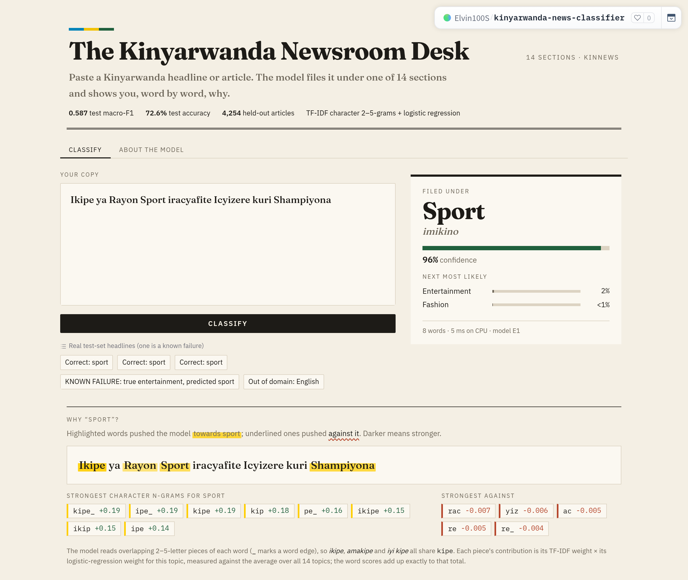

# Kinyarwanda News Topic Classification

A 14-topic classifier for Kinyarwanda news, built on the KINNEWS benchmark (Niyongabo et al.,
2020). Nine models compared on deduplicated splits, from a majority-class floor to fine-tuned
AfroXLMR, with a deployed app that explains every prediction word by word.

| | |
|---|---|
| **Live app** | https://huggingface.co/spaces/Elvin100S/kinyarwanda-news-classifier |
| **Demo video** | [13-minute walkthrough of the notebook and the app](https://drive.google.com/file/d/1pnWpLfbT13-liukdUvSlK16zdxky0rHG/view?usp=sharing) |
| **Report** | [`Kinyarwanda_News_Classification_Report.pdf`](Kinyarwanda_News_Classification_Report.pdf): research questions, method, full results, limitations, references |
| **Notebook** | [`notebooks/kinyarwanda_news_classification.ipynb`](notebooks/kinyarwanda_news_classification.ipynb), the final Kaggle run with all outputs |



## Results

Test macro-F1 on the official KINNEWS test set (4,254 articles), 95% bootstrap CI. Models were
selected on validation, never on test.

| | Model | Val | Test | 95% CI | Params |
|---|---|---|---|---|---|
| **E1** | TF-IDF character 2–5-grams + logistic regression (**selected, deployed**) | **0.699** | 0.587 | 0.571–0.603 | 1.4 M |
| E4 | AfroXLMR base, fine-tuned | 0.653 | **0.614** | 0.598–0.631 | 278 M |
| E2b | BiLSTM + fastText embeddings | 0.671 | 0.526 | 0.508–0.543 | 22 M |
| B1 | TF-IDF word 1–2-grams + logistic regression (baseline) | 0.639 | 0.512 | 0.494–0.528 | 2.8 M |
| E2a | BiLSTM, random embeddings | 0.573 | 0.442 | 0.424–0.458 | 22 M |
| E3 | XLM-R base, fine-tuned | 0.367 | 0.360 | 0.350–0.371 | 278 M |
| B0 | Majority class | 0.027 | 0.013 | 0.012–0.015 | – |

Two ablations of E4 (title only: 0.421; 256 tokens: 0.575) are in the report.

## What we found

- **Character n-grams beat words** by 7.6 points with half the parameters (McNemar
  p = 2.8 × 10⁻¹²). Kinyarwanda builds many forms from one stem, and 61.6% of word types occur
  only once, so pieces of words generalise better than whole words.
- **fastText embeddings lift a BiLSTM** by 8.4 points (p = 2.7 × 10⁻⁴⁸) on all three seeds, but
  22 M parameters on 6,863 articles still overfit and stay below E1.
- **African-centric pretraining matters most:** AfroXLMR beats XLM-R by 25.4 points with the
  identical tokenizer. XLM-R never saw Kinyarwanda and scores zero on four topics.
- **The data needed fixing first.** 55% of the training file is duplicated, 156 groups of
  identical articles carry conflicting labels, and the test set's topic mix differs sharply
  from training. Duplicates were removed before splitting.
- **Selection vs. test:** E1 won on validation and was kept, although AfroXLMR scores higher on
  the shifted test set. Report §5.6 explains why the choice was not changed.

## The app

The app serves E1, which runs on a CPU in milliseconds. Paste a headline or article and it:

- files it under one of 14 sections, in English and Kinyarwanda, with a confidence meter;
- shows **why**: since E1 is linear, each topic score is an exact sum over character n-grams,
  so the app highlights the words that pushed towards or against the topic (the word scores add
  up to the model's score margin, checked to within 10⁻¹⁴);
- warns when confidence is below 0.46, a threshold chosen on validation, because the model
  names a topic even for English or random text.

Re-scoring the full test set through the app reproduces the notebook's E1 result exactly.

## Run it

```bash
# the app
pip install -r app/requirements.txt          # Python 3.12+
python app/app.py

# the notebook: full run on a Kaggle or Colab T4 GPU (~1 h 45 min),
# or set CONFIG["fast_mode"] = True for a ~10-minute CPU smoke test
pip install -r requirements.txt --extra-index-url https://download.pytorch.org/whl/cpu
jupyter lab notebooks/kinyarwanda_news_classification.ipynb
```

## Repository

```
notebooks/   the full pipeline: audit, nine models, ablations, seeds, evaluation, error analysis
results/     one JSON per run (+ seeds/), experiments.csv, significance tests, threshold
figures/     figures from the final run; 09 is the deployed app
data/        split indices and the audit evidence (duplicates, label checks, error samples)
app/         the Gradio app and the saved E1 pipeline
Kinyarwanda_News_Classification_Report.pdf   the written report
scripts/     summarise_manual_review.py
```

## Credits

Data: KINNEWS (Niyongabo et al., 2020, *COLING*), MIT licence. Pretrained models:
`xlm-roberta-base` (Conneau et al., 2020) and `Davlan/afro-xlmr-base` (Alabi et al., 2022).
Built with PyTorch, Hugging Face Transformers, scikit-learn, gensim and Gradio. The full
reference list is in the report.
